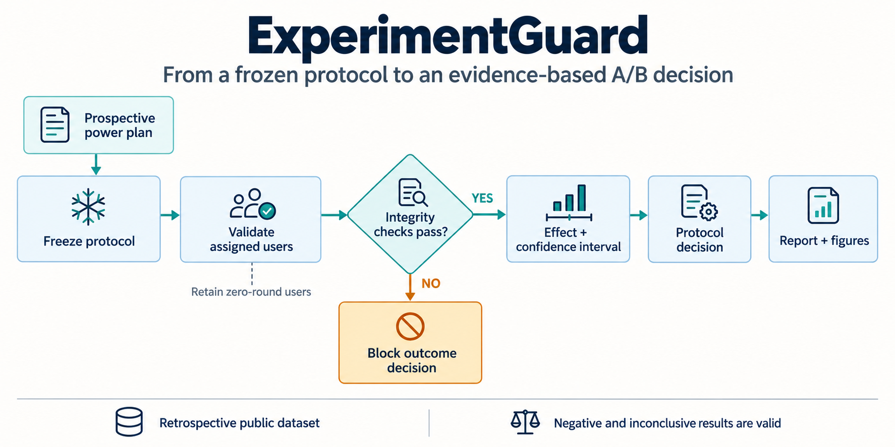
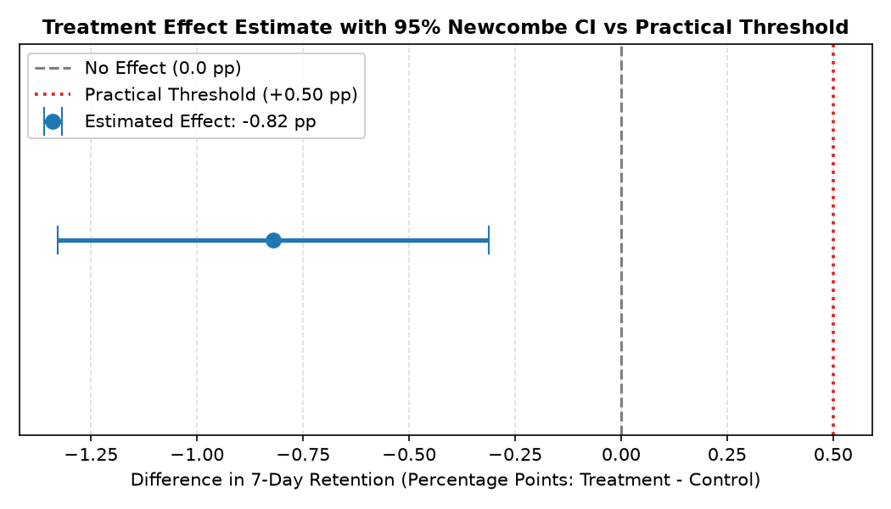

# ExperimentGuard

**Check A/B experiment integrity, estimate treatment effects and make protocol-based decisions.**

[](https://github.com/luqshzeeq3601-art/06_ExperimentGuard_AB_Testing/actions/workflows/ci.yml)
[](LICENSE)

ExperimentGuard is a reproducible analysis package with a CLI, reports, figures and prospective power planning. It retains all assigned users, checks sample-ratio mismatch and separates statistical evidence from a minimum practically meaningful effect. The Cookie Cats case asks whether moving the first progression gate from level 30 to level 40 improves seven-day retention.

## 1. Workflow



The frozen local protocol precedes outcome analysis. This is retrospective analysis of a public snapshot, not prospective preregistration of the original game experiment. Negative and inconclusive findings are valid results.

## 2. Case result

**90,189 assigned users**: gate_30 control N=44,700 and gate_40 treatment N=45,489. Effects use treatment minus control.

| Seven-day retention | Saved result |
| --- | --- |
| Control | **19.02%** |
| Treatment | **18.20%** |
| Difference | **-0.82 percentage points** |
| 95% confidence interval | **[-1.33, -0.31] percentage points** |
| p-value | **0.0016** |
| Illustrative minimum meaningful benefit | **+0.50 percentage points** |
| Protocol decision | **NOT_SUPPORTED**; observed evidence of harm |

Evidence: [analysis JSON](reports/cookie-cats-v1/analysis.json), [decision report](reports/cookie-cats-v1/decision_report.md), [quality checks](reports/cookie-cats-v1/quality.json). Under these data and assumptions, the analysis does not support gate_40. It does not establish a live rollout decision without additional guardrails.



The effect figure is the existing analytical output, not an AI-generated results chart.

## 3. Quick start

Use Python 3.11. Clone/download the same branch or revision as this README, then run from the repository root. The verified updates are currently in [draft PR 1](https://github.com/luqshzeeq3601-art/06_ExperimentGuard_AB_Testing/pull/1) on `fix/portfolio-remediation`.

```sh
python -m venv .venv
```

Activate with `.\.venv\Scripts\Activate.ps1` in Windows PowerShell, or `source .venv/bin/activate` on Linux/macOS.

```sh
python -m pip install -r requirements.lock.txt
python -m pip install --no-deps -e .
```

### Run the included synthetic fixture

```sh
python -m experimentguard validate --data tests/fixtures/valid_experiment.csv --config configs/experiment.yaml --out reports/demo-validate
python -m experimentguard analyze --data tests/fixtures/valid_experiment.csv --config configs/experiment.yaml --out reports/demo-analyze
python -m experimentguard plan --config configs/experiment.yaml --out reports/demo-plan
```

This exercises the package/report workflow without acquiring the full dataset. Synthetic output is a software demonstration; use the saved real-data reports above for the case findings.

### Reproduce the public case

Acquire the separately distributed Cookie Cats input using [the source manifest](data/source_manifest.json), inspect source terms and verify the recorded checksum. Once it is at `data/raw/cookie_cats.csv`:

```sh
python -m experimentguard analyze --data data/raw/cookie_cats.csv --manifest data/source_manifest.json --config configs/experiment.yaml --out reports/cookie-cats-reproduced
```

The frozen protocol is [configs/experiment.yaml](configs/experiment.yaml); [the protocol document](docs/03_EXPERIMENT_PROTOCOL.md) defines exclusions, direction, integrity gates and decision thresholds. The raw dataset is not redistributed in this repository.

### Optional dashboard

The dashboard is an extra interface outside core V1 completion. To use the existing entrypoint:

```sh
python -m pip install -r requirements-app.txt
python -m streamlit run app.py
```

## 4. Verification and capacity

```sh
python -m pytest tests -q -p no:cacheprovider --basetemp .pytest_tmp
python -m ruff check src tests
python -m ruff format --check src tests
```

CI runs tests and synthetic validate/analyze/plan commands. Separate full-CLI benchmark receipts record:

| Workload | Wall time | Sampled process-tree RSS |
| --- | --- | --- |
| Public 90,189-row case | **2.57 s** | **193.6 MiB** |
| Constructed balanced synthetic 100,000-row capacity case | **2.60 s** | **195.6 MiB** |

[Real-case receipt](reports/benchmark-20261006/receipt.json) · [100k capacity receipt](reports/benchmark-synthetic-100000/receipt.json). RSS is sampled across the recursive process tree, including the Windows launcher; it is not Python-only allocation tracking. The constructed workload does not support experimental inference.

## 5. Limitations

- Random assignment is reported by the source; original randomization logs are absent.
- Installation timestamps are missing, so complete seven-day maturity cannot be independently verified. Zero-round users remain in the analysis.
- Revenue, monetization and infrastructure guardrails are unavailable. Retention alone cannot establish commercial rollout readiness.
- The +0.50 pp practical threshold and power-planning baseline are illustrative assumptions. Secondary outcomes are exploratory and adjusted as documented.
- No predictive model, model-serving API or cloud deployment is required by core V1.

## 6. Documentation and contributions

[Start here](docs/00_START_HERE.md) · [Data specification](docs/04_DATA_SPEC.md) · [Technical design](docs/05_TECHNICAL_DESIGN.md) · [Tasks](tasks/todo.md) · [Progress](docs/09_PROGRESS_LOG.md) · [Sources](docs/10_SOURCES.md) · [Diagram notes and prompt](docs/assets/workflow.md)

Follow [AGENTS.md](AGENTS.md). Preserve all assigned users, the frozen protocol and effect direction; do not alter thresholds to prefer a positive finding.

## 7. License and data

Project code/documentation use the [MIT license](LICENSE). Cookie Cats has separate source/distribution terms and attribution recorded in [the source manifest](data/source_manifest.json). Saved analytical reports and synthetic fixtures are included; the raw snapshot is acquired separately.
