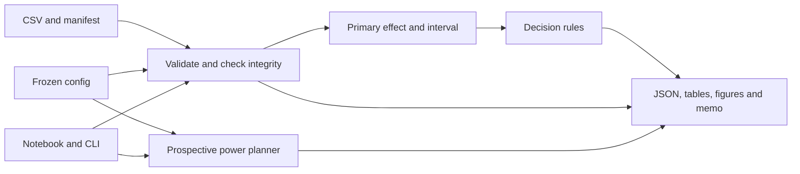

# 05. Technical Design

## 1. Architecture



CLI and notebook call shared package functions. Renderer consumes result objects without recalculating statistics. Validation failure stops inference and exports diagnostics when possible.

## 2. Planned structure

```text
06_ExperimentGuard_AB_Testing/
  AGENTS.md, README.md, docs/, tasks/       # Existing planning files
  pyproject.toml                          # src package and lint/test config
  requirements.in, requirements.lock.txt # Direct and pinned dependencies
  configs/experiment.yaml                 # Frozen protocol settings
  data/source_manifest.json
  data/raw/cookie_cats.csv
  data/processed/validated.csv
  src/experimentguard/
    __init__.py, __main__.py
    config.py                             # Settings and hashes
    data.py                               # Parsing and validation
    integrity.py                          # Assignment/SRM checks
    effects.py                            # Rates, intervals, tests
    power.py                              # Prospective sample planning
    decision.py                           # Pure ordered decision rules
    report.py                             # Shared result rendering
    cli.py                                # validate/analyze/plan
  tests/, tests/fixtures/
  notebooks/01_cookie_cats_analysis.ipynb
  reports/<run_id>/
  .github/workflows/ci.yml
```

Only Markdown plans exist now. Create other files at their assigned tasks.

## 3. Module contracts

| Module | Input -> output | Constraint |
|---|---|---|
| config | YAML -> typed settings/hash | Reject invalid units/settings |
| data | CSV/manifest -> typed frame/diagnostics | No silent filtering |
| integrity | Frame/allocation -> counts/SRM/evidence | Own decision blockers |
| effects | Arm outcomes -> rates/interval/test | B-minus-A consistently |
| power | Baseline/MDE/settings -> sample requirements | No observed-effect power |
| decision | Quality/effect -> status/reasons | Pure, ordered protocol rules |
| report | Shared objects -> exports | Formatting cannot alter decision |
| cli | Paths/command -> outputs/exit code | Same logic as notebook |

## 4. Configuration contract

Planned `configs/experiment.yaml`:

```yaml
experiment_id: cookie_cats_gate_placement
protocol_version: '1.0'
control: gate_30
treatment: gate_40
primary_metric: retention_7
alpha: 0.05
alternative: two-sided
confidence_method: newcomb
minimum_meaningful_effect_absolute: 0.005
expected_treatment_fraction: 0.5
allocation_evidence: assumed
srm_alpha: 0.001
seed: 42
bootstrap_replicates: 10000
planning:
  baseline_rate: 0.20
  target_power: 0.80
  mde_absolute: [0.0025, 0.005, 0.01]
```

Manifest owns source evidence; config owns analytical assumptions. Validate consistency; never silently overwrite contradictions. Hash exact frozen YAML bytes and copy them into each run.

## 5. JSON contract

`analysis.json` contains:

```text
schema_version, experiment_id, run_id, created_at
data_sha256, protocol_sha256, package_versions, seed
quality:
  status: pass | provisional | fail
  assignment_evidence: verified | reported | unverified
  allocation_evidence: verified | assumed
  maturity_evidence, n_control, n_treatment
  srm_pvalue, srm_threshold, srm_status, blockers[], limitations[]
primary:
  metric, control, treatment, retained_control, retained_treatment
  rate_control, rate_treatment, rate_control_ci[], rate_treatment_ci[]
  effect_absolute, effect_percentage_points
  relative_change_percent: number | null
  relative_change_unavailable_reason: string | null
  ci_absolute[], confidence_level, confidence_method
  pvalue, test_method, alternative
decision:
  status: supported | not_supported | inconclusive | blocked
  reason_codes[], explanation, practical_threshold_absolute
  evidence_qualification: verified | provisional
secondary: results or explicit unavailable/not-run status
```

Blocked inputs may have null primary result with a reason. JSON must not contain NaN/infinity. This contract is a plan, not fabricated sample findings.

## 6. Run outputs

| File | Content |
|---|---|
| `quality.json` | Validation, assignment diagnostics, failures |
| `analysis.json` | Primary result and decision |
| `summary.csv` | Counts, rates, signed effects, intervals, tests |
| `power_plan.csv` | Assumptions, MDE, allocation, required arm sizes |
| `decision_report.md` | Manager memo |
| `figures/retention_rates.png` | Arm rates with intervals |
| `figures/retention_effect.png` | Effect interval, zero, practical threshold |
| `figures/power_sensitivity.png` | Required sample size by MDE |
| `run_metadata.json` | Commands, hashes, versions, runtime, limitations |
| `experiment.yaml` | Exact frozen run settings |

Failure emits diagnostics/available metadata, not stale success files. Use a new run directory and refuse overwrite. Same data/settings reproduce analytical content; run IDs/timestamps may differ.

## 7. Coding conventions

- Typed small functions; explicit statistical method keywords.
- Store probabilities as 0-1; convert units only in named report fields.
- Avoid mutable global config and machine-specific source paths.
- Record seed/methods; reuse result objects across exports.
- Example:

```python
def retention_rate(*, retained: int, assigned: int) -> float:
    if assigned <= 0 or not 0 <= retained <= assigned:
        raise ValueError("Expected 0 <= retained <= assigned and assigned > 0")
    return retained / assigned
```

## 8. CLI exit behaviour

- Exit 0: valid full analysis, including negative/inconclusive findings.
- Exit 2: invalid data/configuration or integrity-blocked decision.
- Exit 1: missing files, unexpected calculation failure, output conflict.
- A successful process does not mean treatment improvement.
